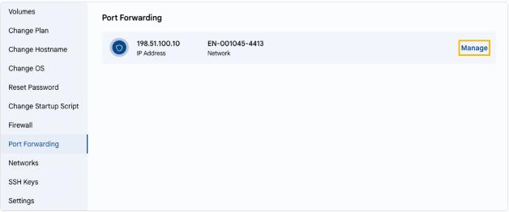

# Portlarni yoʻnaltirish

## Portlarni yoʻnaltirish

Portlarni yoʻnaltirish ommaviy IP manzil portidagi trafikni virtual mashina portiga yoʻnaltiradi. Masalan, tashqi 8080-portni VM’ning 80-portiga yoʻnaltirish mumkin.

---

- **VM Settings** yorligʻida **Port Forwarding** ni tanlang. Roʻyxatda VM’ning ommaviy IP manzillari va ularning tarmoqlari koʻrsatiladi.
- IP manzil yonidagi **Manage** ni bosing. Ommaviy IP manzil sahifasi **Port Forwarding** yorligʻida ochiladi, u yerda qoidalarni qoʻshish va oʻchirish mumkin.

---

### Xulosa

Portlarni yoʻnaltirish VM’dagi xizmatlarga kirishni ochish imkonini beradi. Faqat haqiqatan ham kerakli portlarni oching.

> [!TIP]
> **Shuningdek qarang:**
>
> - **[Ommaviy IP manzil](../../networks/public-ip-address.md)**
