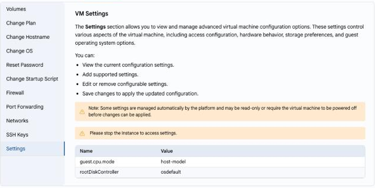

# VM parametrlari

## VM’ning kengaytirilgan parametrlari

**Settings** boʻlimi virtual mashinaning kengaytirilgan konfiguratsiya parametrlarini koʻrsatadi: kirish, uskunaning ishlashi, xotira va mehmon OT parametrlari (masalan, `guest.cpu.mode` yoki `rootDiskController`).

---

- **VM Settings** yorligʻida **Settings** ni tanlang.
- Bu yerda joriy parametrlarni koʻrish, qoʻllab-quvvatlanadiganlarini qoʻshish, sozlanadiganlarini oʻzgartirish yoki oʻchirish va oʻzgarishlarni saqlash mumkin.

> [!NOTE]
> Parametrlarning bir qismi platforma tomonidan avtomatik boshqariladi va faqat oʻqish uchun mavjud. Parametrlarni oʻzgartirish uchun avval virtual mashinani toʻxtating.

> [!WARNING]
> Ushbu parametrlarni faqat ularning vazifasini tushunsangiz oʻzgartiring: notoʻgʻri qiymatlar VM’ning ishga tushishiga xalaqit berishi mumkin.
