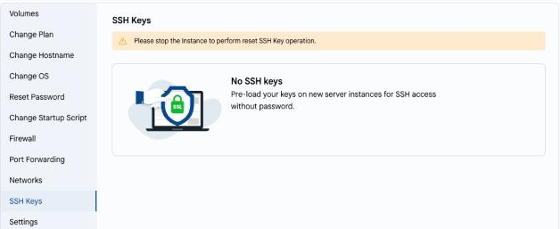

# SSH kalitlar

## SSH kalit orqali kirish

SSH kalitlar virtual mashinaga parolsiz xavfsiz kirishni taʼminlaydi.

---

- VM’ning SSH kalitlarini koʻrish uchun **VM Settings** yorligʻida **SSH Keys** ni tanlang.

> [!WARNING]
> SSH kalitni qayta tiklash uchun virtual mashinani toʻxtatish kerak.

---

### Xulosa

Kalit orqali autentifikatsiya paroldan xavfsizroq. SSH kalitlarni muntazam tekshirib turing va foydalanilmayotganlarini oʻchiring.

> [!TIP]
> **Shuningdek qarang:**
>
> - **[SSH orqali ulanish](../connect-with-ssh.md)**
