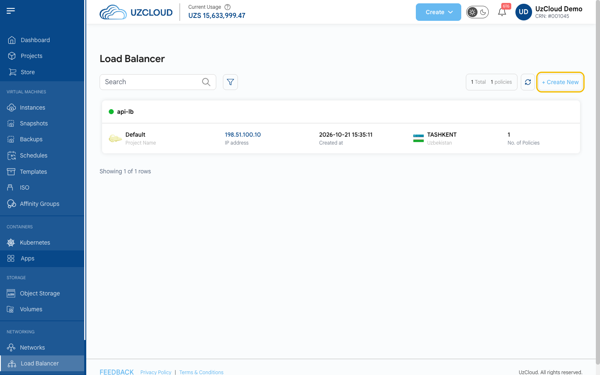
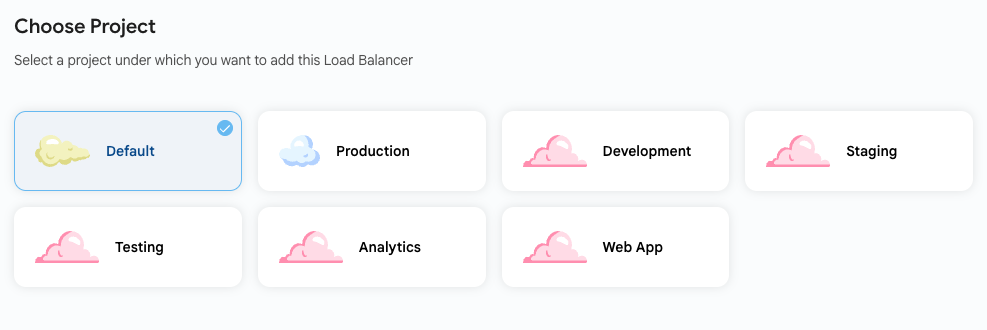
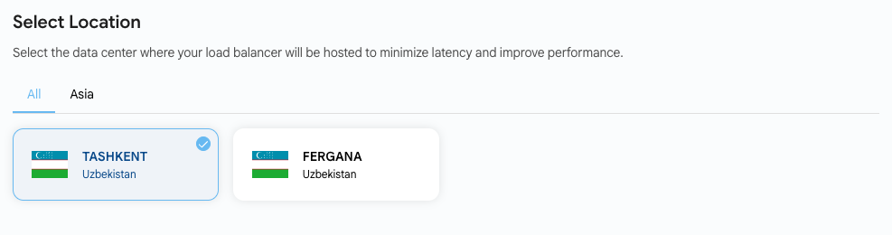
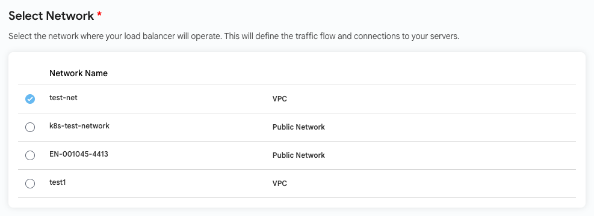
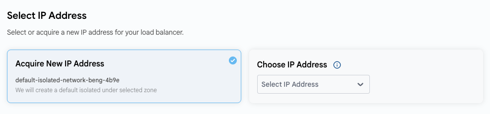
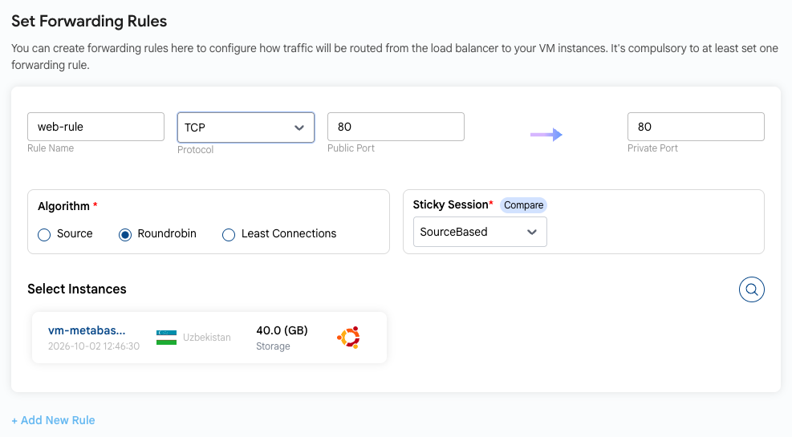
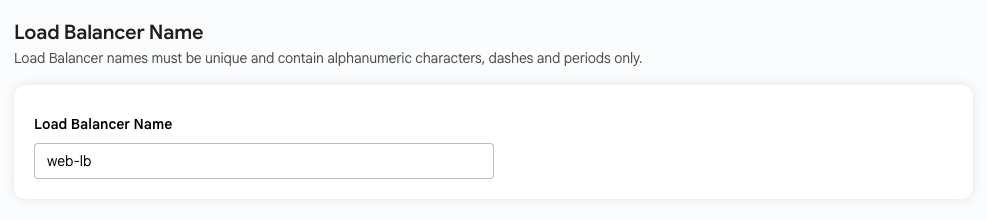
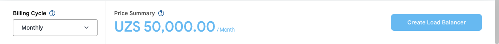
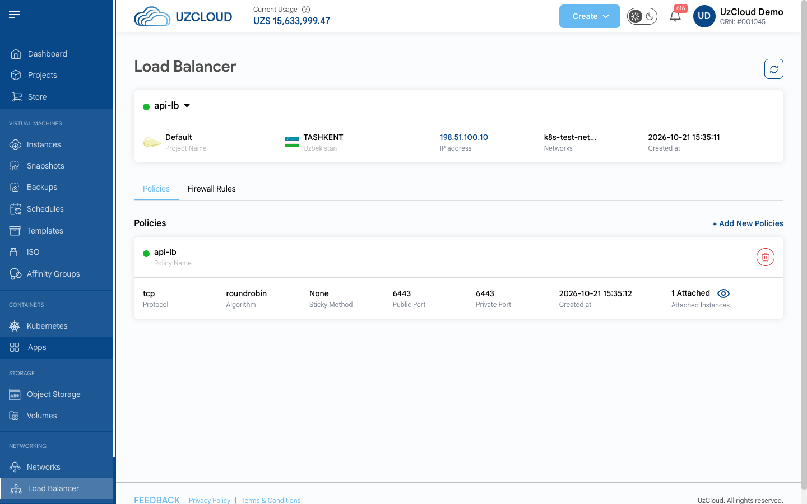
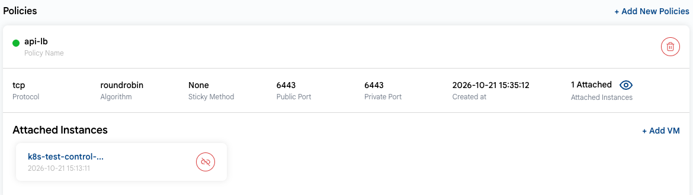

# Yuklama muvozanatlagich

## Yuklama muvozanatlagich

**Yuklama muvozanatlagich** (Load Balancer) kiruvchi trafikni bir nechta serverlar oʻrtasida taqsimlab, yuqori mavjudlik, ishonchlilik va unumdorlikni taʼminlaydi. UzCloud’da muvozanatlagichni veb-ilovalar, maʼlumotlar bazalari va boshqa xizmatlar uchun sozlash mumkin. Ushbu qoʻllanmada yuklama muvozanatlagichni yaratish va boshqarish tushuntiriladi.

---

### Load Balancer sahifasini oching

- Chap menyuning **NETWORKING** boʻlimida **Load Balancer** ni bosing. Sahifada muvozanatlagichlaringiz koʻrsatiladi: loyiha, IP manzil, yaratilgan sana, joylashuv va siyosatlar soni.
- Yuqori oʻng burchakdagi **+ Create New** tugmasini bosing. **Create Load Balancer** sahifasi ochiladi.

### Loyihani tanlang

- Resurslarni tartibga solish uchun muvozanatlagichni loyihalaringizdan biriga biriktiring.

### Joylashuvni tanlang

- Muvozanatlagich joylashadigan maʼlumotlar markazini tanlang: **TASHKENT** yoki **FERGANA**.

### Tarmoqni tanlang

- Muvozanatlagich ishlaydigan tarmoqni tanlang (VPC yoki ommaviy tarmoq). Muvozanatlagich trafikni qaysi VM’larga yoʻnaltira olishi tarmoqqa bogʻliq.

### IP manzilni tanlang

- **Acquire New IP Address** — konsol muvozanatlagich uchun yangi ommaviy IP manzil oladi (kerak boʻlsa, tanlangan zonada standart izolyatsiya qilingan tarmoq yaratiladi).
- **Choose IP Address** — mavjud IP manzillaringizdan birini tanlang.

### Yoʻnaltirish qoidalarini sozlang

Yoʻnaltirish qoidalari trafik muvozanatlagichdan VM’larga qanday yoʻnaltirilishini belgilaydi. Kamida bitta qoida talab qilinadi.

- **Rule Name** maydoniga qoida nomini kiriting (kamida 5 ta belgi).
- Protokolni (**Protocol**) tanlang: **TCP** yoki **TCP Proxy**.
- Muvozanatlagich trafikni qabul qiladigan ommaviy portni (**Public Port**) va VM’dagi ichki portni (**Private Port**) kiriting.
- Soʻrovlarni taqsimlash algoritmini (**Algorithm**) tanlang:
  - **Source** — bitta mijoz IP manzilidan kelgan soʻrovlarni bitta VM’ga yoʻnaltiradi.
  - **Roundrobin** — soʻrovlarni barcha VM’lar oʻrtasida navbat bilan teng taqsimlaydi.
  - **Least Connections** — soʻrovlarni faol ulanishlari eng kam boʻlgan VM’ga yoʻnaltiradi.
- Seanslarni biriktirish usulini (**Sticky Session**) tanlang, masalan **SourceBased** — mijoz seansi uning IP manzili boʻyicha bitta VM’ga biriktiriladi. Mavjud usullarni solishtirish uchun **Compare** ni bosing.
- **Select Instances** blokida trafikni qabul qiladigan VM’larni tanlang.
- Yana bitta qoida qoʻshish uchun **+ Add New Rule** ni bosing.

### Muvozanatlagich nomini kiriting

- **Load Balancer Name** maydoniga nom kiriting. Nom noyob boʻlishi va faqat lotin harflari, raqamlar, chiziqcha va nuqtalardan iborat boʻlishi kerak.

### Muvozanatlagichni yarating

- Sahifaning pastki qismida **Billing Cycle** (toʻlov davri) ni tanlang: **Monthly** (oylik) yoki **Yearly** (yillik). **Price Summary** da muvozanatlagich narxi koʻrsatiladi.
- Konfiguratsiyani tekshiring va **Create Load Balancer** tugmasini bosing.

### Muvozanatlagichni koʻrish

- Muvozanatlagich sahifasini ochish uchun uning nomini bosing. Unda loyiha, joylashuv, IP manzil, tarmoq va yaratilgan sana koʻrsatiladi. Maʼlumotlarni yangilash uchun yuqori oʻng burchakdagi **Refresh** ni bosing.
- **Policies** yorligʻida yoʻnaltirish qoidalari keltirilgan: protokol, algoritm, seanslarni biriktirish usuli, ommaviy va ichki portlar, yaratilgan sana va ulangan VM’lar soni. Qoida qoʻshish uchun **+ Add New Policies** ni bosing; oʻchirish uchun uning kartochkasidagi oʻchirish belgisini bosing.
- **Firewall Rules** yorligʻida muvozanatlagich IP manzili uchun xavfsizlik devori qoidalari keltirilgan: manba CIDR, protokol, ICMP turi va kodi, portlar oraligʻi. Qoida qoʻshish uchun **+ Add A Firewall Rule** ni bosing.

- Siyosatga ulangan VM’larni koʻrish uchun **Attached Instances** yonidagi koʻz belgisini bosing. Yana bitta VM ulash uchun **+ Add VM** ni bosing; VM’ni uzish uchun uning kartochkasidagi uzish belgisini bosing.

### Xulosa

Ushbu qoʻllanmaga amal qilib, siz UzCloud’da yuklama muvozanatlagichni yaratishingiz va boshqarishingiz mumkin. Muvozanatlagichlar kiruvchi trafikni bir nechta serverlar oʻrtasida taqsimlab, yuqori mavjudlik, ishonchlilik va unumdorlikni taʼminlaydi. Yordam kerak boʻlsa, UzCloud hujjatlarini oʻrganing yoki qoʻllab-quvvatlash xizmatiga murojaat qiling.

> [!TIP]
> **Shuningdek qarang:**
>
> - **[Ommaviy tarmoq](../networks/public-network/create-public-network.md)**
> - **[VPC tarmogʻi](../networks/vpc-network/create-vpc-network.md)**
> - **[Affinity guruhlari](../affinity-groups/create-affinity-groups.md)**
> - **[Ommaviy IP manzil](../networks/public-ip-address.md)**
> - **[Shablonlar yaratish](../templates/create-templates.md)**
