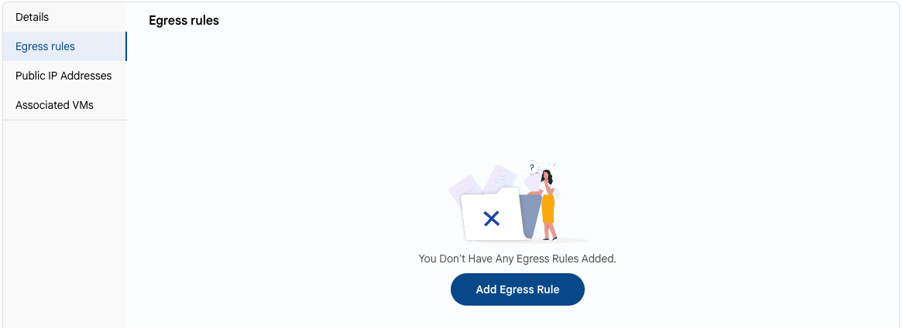
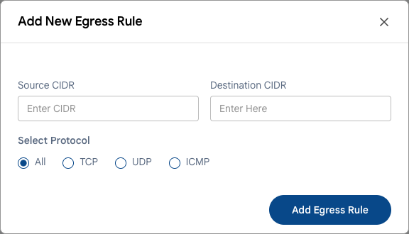

# Chiquvchi trafik qoidalari

## Chiquvchi trafik qoidalari (Egress Rules)

Chiquvchi trafik qoidasi protokol va manzillar oraligʻiga qarab tarmoqdan koʻrsatilgan manzilga qaysi trafik chiqishi mumkinligini belgilaydi.

- Tarmoq sahifasida **Egress rules** yorligʻini oching. Unda tarmoqning chiquvchi trafik qoidalari keltirilgan.
- **Add Egress Rule** ni bosing.

### Qoida qoʻshish

- Manba oraligʻini (**Source CIDR**) va manzil oraligʻini (**Destination CIDR**) kiriting.
- Protokolni tanlang: **All**, **TCP**, **UDP** yoki **ICMP**.
- **Add Egress Rule** tugmasini bosing.

### Xulosa

**Chiquvchi trafik qoidalari** tarmoqdan qaysi trafik chiqishini nazorat qilish va xavfsizlikni oshirish imkonini beradi.
