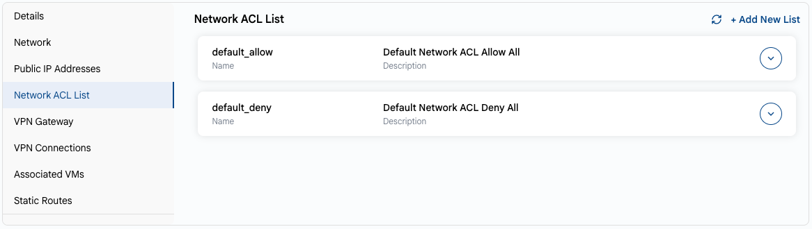
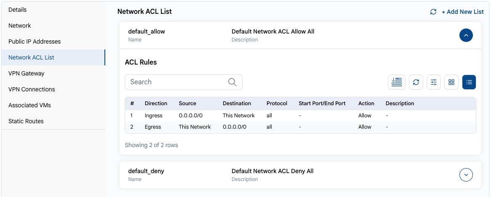

# Tarmoq ACL roʻyxati

## Tarmoq ACL roʻyxati

**Tarmoq ACL**’i — VPC tarmoqlarining kiruvchi va chiquvchi trafigini boshqaradigan qoidalar toʻplami.

- VPC sahifasida **Network ACL List** yorligʻini oching. Unda VPC’ning barcha ACL’lari keltirilgan. Standart holatda ikkita roʻyxat yaratiladi: **default_allow** (barcha trafikka ruxsat beradi) va **default_deny** (barcha trafikni taqiqlaydi).

- ACL qoidalarini (**ACL Rules**) koʻrish uchun ACL kartochkasidagi strelkani bosing: raqam, yoʻnalish (**Ingress** yoki **Egress**), manba, manzil, protokol, portlar oraligʻi, amal (**Allow** yoki **Deny**) va tavsif. **Manage Order** tugmasi qoidalar tartibini oʻzgartirish imkonini beradi.

- Oʻz roʻyxatingizni yaratish uchun **+ Add New List** ni bosing, nom (**Name**) va tavsif (**Description**) kiriting va **Submit** tugmasini bosing.

### Xulosa

**Tarmoq ACL roʻyxati** VPC tarmoqlari uchun kiruvchi va chiquvchi trafik qoidalarini markazlashgan tarzda boshqarish imkonini beradi.

> [!TIP]
> **Shuningdek qarang:**
>
> - **[VPC tarmogʻi sharhi](network-overview.md)**
> - **[VPC tarmogʻini yaratish](create-vpc-network.md)**
> - **[VPN shlyuzi](vpn-gateway.md)**
> - **[VPN ulanishlari](vpn-connections.md)**
