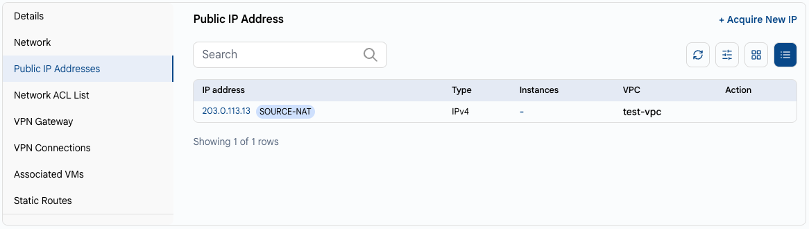
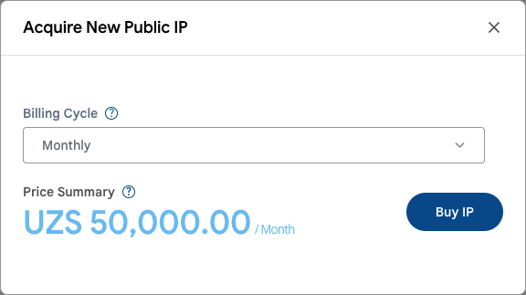

# Ommaviy IP manzil

## Ommaviy IP manzil

Ommaviy IP manzillar VPC resurslariga internet bilan oʻzaro aloqa qilish imkonini beradi.

- VPC sahifasida **Public IP Addresses** yorligʻini oching. Unda VPC’ning IP manzillari keltirilgan: turi, VM’lar va VPC. **SOURCE-NAT** manzili VPC’ga avtomatik tayinlanadi va chiquvchi trafik uchun ishlatiladi.

- Yana bitta manzil olish uchun **+ Acquire New IP** ni bosing.
- **Billing Cycle** ni tanlang, **Price Summary** ni tekshiring va **Buy IP** tugmasini bosing.

- Manzil uchun xavfsizlik devori, portlarni yoʻnaltirish va VPN’ni sozlash haqida **[Ommaviy IP manzil](../public-ip-address.md)** ga qarang.

### Xulosa

**Public IP Addresses** yorligʻida VPC’ning IP manzillarini koʻrish, olish va sozlash mumkin.

> [!TIP]
> **Shuningdek qarang:**
>
> - **[VPC tarmogʻi sharhi](network-overview.md)**
> - **[VPC tarmogʻini yaratish](create-vpc-network.md)**
> - **[VPN shlyuzi](vpn-gateway.md)**
> - **[VPN ulanishlari](vpn-connections.md)**
