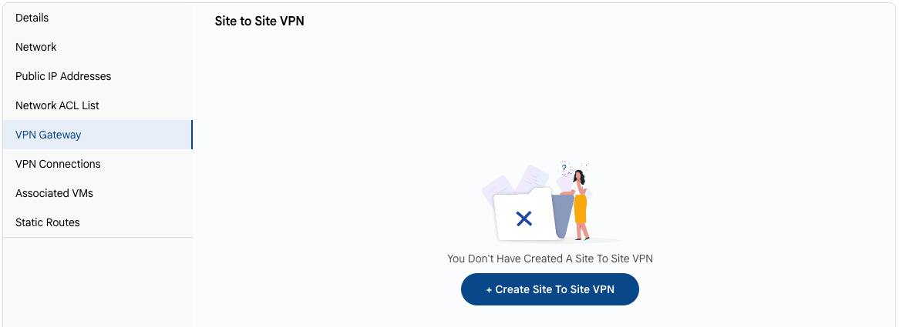

# VPN shlyuzi

## VPN shlyuzi

**VPN shlyuzi** VPC va tashqi tarmoqlar, masalan mahalliy maʼlumotlar markazi yoki boshqa bulut oʻrtasida xavfsiz aloqani taʼminlaydi.

- VPC sahifasida **VPN Gateway** yorligʻini oching. Unda «tarmoq — tarmoq» ulanishlari uchun VPC’ning VPN shlyuzi koʻrsatiladi.
- Agar shlyuz hali boʻlmasa, **+ Create Site To Site VPN** ni bosing.

### Xulosa

**VPN shlyuzi** — VPC va tashqi tarmoqlar oʻrtasidagi xavfsiz koʻprik. U yaratilgach, ulanishlarni **[VPN Connections](vpn-connections.md)** yorligʻida sozlang.

> [!TIP]
> **Shuningdek qarang:**
>
> - **[VPC tarmogʻi sharhi](network-overview.md)**
> - **[Tarmoq ACL roʻyxati](network-acl-list.md)**
> - **[VPN ulanishlari](vpn-connections.md)**
