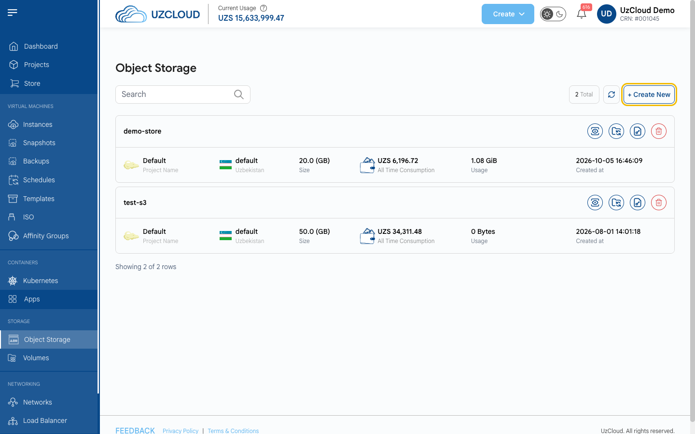
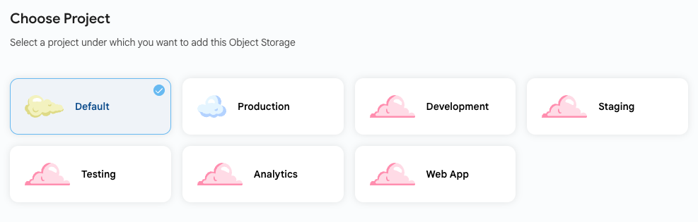
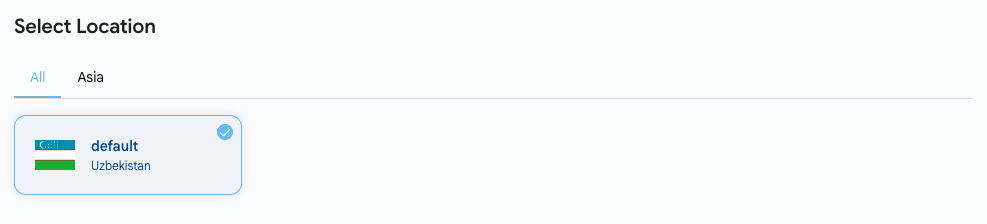
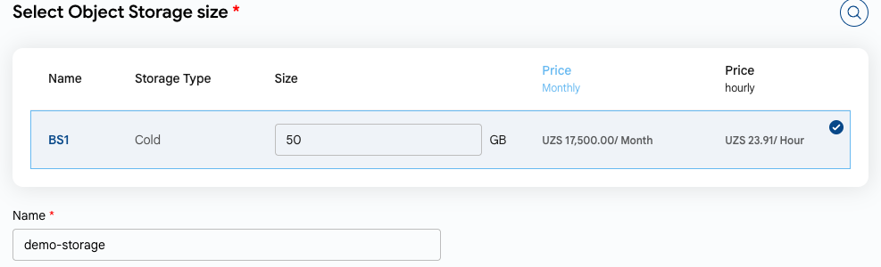
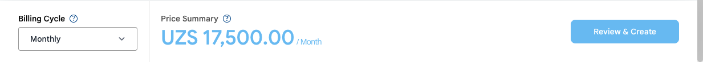

# Obyektli xotira yaratish

## S3 obyektli xotirasi

UzCloud **obyektli xotirasi** — bu **Ceph** asosidagi S3 bilan mos xotira. U fayllar, zaxira nusxalar, media va boshqa tuzilmagan maʼlumotlar uchun moʻljallangan va istalgan S3 mijozlari hamda SDK’lar bilan ishlaydi. Quyida UzCloud konsolida obyektli xotira yaratish tartibi keltirilgan.

---

### Object Storage sahifasini oching

- Chap menyuning **STORAGE** boʻlimida **Object Storage** ni bosing. Sahifada xotiralaringiz koʻrsatiladi: loyiha, joylashuv, hajm, butun davrdagi isteʼmol, foydalanilgan hajm va yaratilgan sana.
- Yuqori oʻng burchakdagi **+ Create New** tugmasini bosing. **Create Object Storage** sahifasi ochiladi.

### Loyihani tanlang

- Resurslarni tartibga solish uchun xotirani loyihalaringizdan biriga biriktiring.

### Joylashuvni tanlang

- Xotira joylashadigan joyni tanlang.

### Hajm va nomni kiriting

- **Select Object Storage size** blokida xotira hajmini GB’da kiriting. Oylik va soatlik narxlar avtomatik hisoblanadi.
- **Name** maydoniga xotira nomini kiriting.

### Xotirani yarating

- Sahifaning pastki qismida **Billing Cycle** (toʻlov davri) ni tanlang: **Monthly** (oylik) yoki **Yearly** (yillik). **Price Summary** da tanlangan konfiguratsiya narxi koʻrsatiladi.
- Konfiguratsiyani tekshiring va **Review & Create** tugmasini bosing.

### Xulosa

Ushbu qoʻllanmaga amal qilib, siz UzCloud’da S3 bilan mos obyektli xotira yaratishingiz mumkin. Keyin bucketlar yarating va kirish kalitlarini oling — **[Obyektli xotirani boshqarish](manage-object-storage.md)** ga qarang. Yordam kerak boʻlsa, UzCloud hujjatlarini oʻrganing yoki qoʻllab-quvvatlash xizmatiga murojaat qiling.
