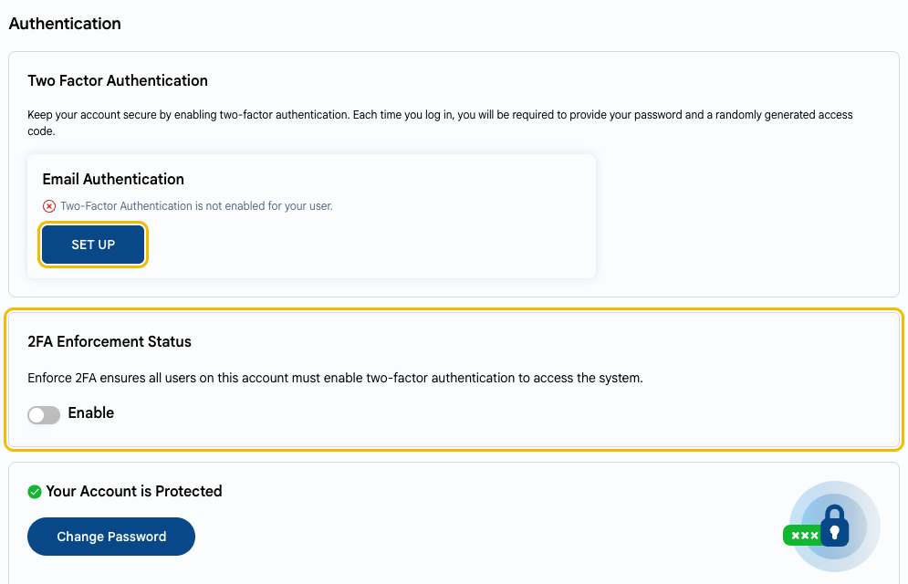
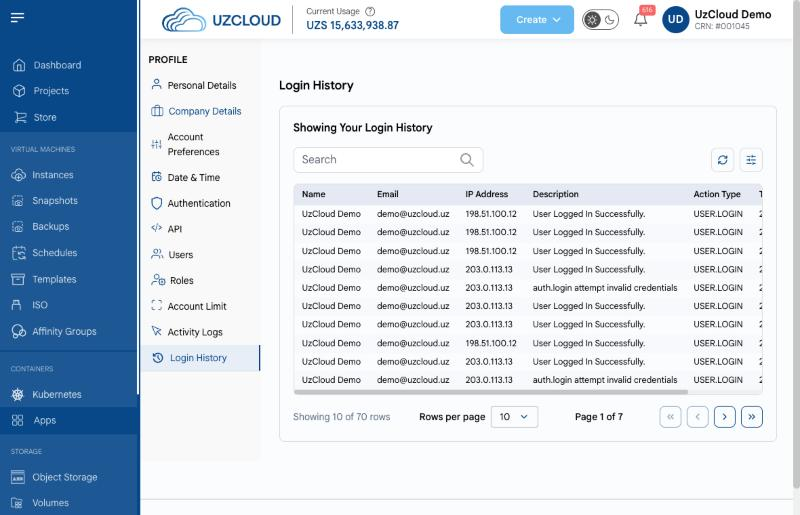

# Hisob xavfsizligi

## UzCloud hisobingizni himoya qiling

UzCloud hisobingizni boshqaradigan kishi barcha VM’lar, disklar va zaxira nusxalarni boshqaradi. Hisobni serverlar kabi ehtiyotkorlik bilan himoya qiling.

---

### Ikki bosqichli autentifikatsiyani yoqing

Ikki bosqichli autentifikatsiya (2FA) parol sizib chiqsa ham hisobni himoya qiladi: har safar kirishda elektron pochtaga yuborilgan bir martalik kodni ham kiritish kerak boʻladi.

- **Profile → Authentication** ni oching va **Email Authentication** blokida **SET UP** ni bosing.
- Agar siz hisob egasi boʻlsangiz, **2FA Enforcement Status** ni yoqing: shunda hisobning barcha foydalanuvchilari tizimga kirish uchun ikki bosqichli autentifikatsiyani yoqishi shart boʻladi.

Shuningdek **[Profilni sozlash](../getting-started/profile-setup.md#ikki-bosqichli-autentifikatsiya)** ga qarang.

### Murakkab va noyob paroldan foydalaning

Boshqa xizmatlarda ishlatmaydigan uzun paroldan foydalaning va uni parollar menejerida saqlang. Sizib chiqishdan shubhalansangiz, parolni darhol oʻzgartiring.

### Foydalanuvchilar va rollarni ajrating

- Barcha xodimlar uchun bitta hisobdan foydalanmang. Har bir xodim uchun alohida foydalanuvchi qoʻshing: **Profile → Users**.
- Har bir foydalanuvchiga faqat kerakli rolni bering. Masalan, buxgalterga VM’larni boshqarish emas, billingga kirish kerak.
- Kirish endi kerak boʻlmagan foydalanuvchilarni, masalan xodim ishdan ketgandan keyin, oʻchiring.

**[Profilni sozlash](../getting-started/profile-setup.md#yangi-foydalanuvchi-qoʻshish)** ga qarang.

### API tokenlari va kirish kalitlarini xavfsiz saqlang

- API tokenlari va S3 kirish kalitlarini kod repozitoriylarida saqlamang va messenjerlarda yubormang.
- Har bir ilovaga alohida kalit bering, shunda uni boshqalariga taʼsir qilmasdan bekor qilish mumkin boʻladi.
- Kalitlarni muntazam almashtiring va sizib chiqqan boʻlishi mumkin boʻlgan kalitni darhol bekor qiling. Obyektli xotira uchun **[Obyektli xotirani boshqarish](../object-storage/manage-object-storage.md#kirish-maʼlumotlarini-koʻrish)** ga qarang.
- Agar bucketlarda ommaviy fayllar boʻlmasa, ularni ommaviy qilmang.

### Hisobdagi faollikni kuzatib boring

Profildagi **Activity Logs** va **Login History** boʻlimlarini muntazam koʻrib chiqing. Notanish kirishlar yoki siz bajarmagan amallar — parolni oʻzgartirish va qoʻllab-quvvatlash xizmatiga murojaat qilish uchun sabab.

---

### Xulosa

2FA, minimal rollarga ega alohida foydalanuvchilar va kalitlarga ehtiyotkorlik bilan munosabatda boʻlish hisobni va undagi barcha resurslarni himoya qiladi.

> [!TIP]
> **Shuningdek qarang:**
>
> - **[Xavfsizlik boʻyicha nazorat roʻyxati](security-checklist.md)**
