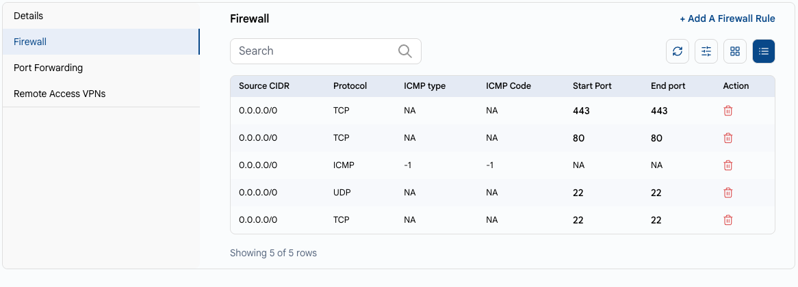
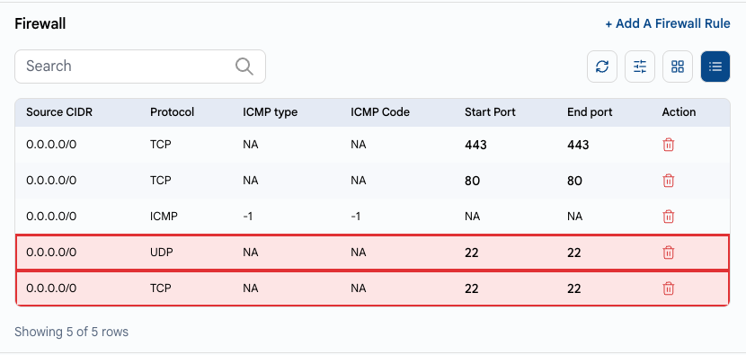
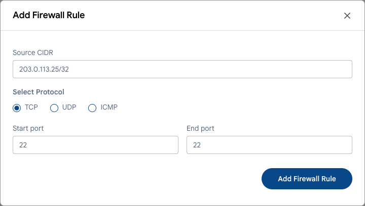

# Tarmoqqa kirish

## Faqat keraklisini oching

Har bir ochiq port — potentsial kirish nuqtasi. Butun internet uchun ochiq maʼlumotlar bazasi, administrator paneli yoki masofaviy kirish portini skanerlar bir necha soat ichida topadi.

---

### 1-qoida. Faqat kerakli portlarni oching

UzCloud’da ommaviy IP manzilga kiruvchi trafik konsoldagi **xavfsizlik devori qoidalari** bilan boshqariladi. Port internetdan faqat unga qoida mavjud boʻlsa ochiq boʻladi.

- VM’ning ommaviy IP manzilini oching: **Networks → Public IP Address** yoki VM sozlamalaridagi **Firewall** yorligʻi. **[Ommaviy IP manzil](../networks/public-ip-address.md)** va **[Xavfsizlik devori](../compute/vm-settings/firewall.md)** ga qarang.
- Qoidalarni koʻrib chiqing va keraksizlarini oʻchiring.
- Veb-portlarni (80, 443) hamma uchun faqat VM ommaviy saytga xizmat koʻrsatsa oching.



### 2-qoida. Masofaviy kirishni IP boʻyicha cheklang

SSH (22) va RDP (3389) ni `0.0.0.0/0` uchun ochmang. Quyidagi misolda SSH butun internet uchun ochiq — botlar aynan shunday serverlarni qidiradi:



Bunday qoidalarni oʻchiring va faqat oʻz manzillaringiz uchun qoida qoʻshing. **Source CIDR** maydonida faqat siz ulanadigan manzillarni koʻrsating, masalan, `/32` niqobli ofis IP manzili.



Agar siz oʻzgaruvchan manzillardan ulansangiz, **masofaviy kirish VPN’idan** foydalaning: uni ommaviy IP manzilda yoqing, VPN foydalanuvchilarini qoʻshing va SSH/RDP’ga faqat xususiy tarmoq ichida ruxsat bering. **[Ommaviy IP manzil](../networks/public-ip-address.md#masofaviy-kirish-vpni)** va **[VPN foydalanuvchilari](../networks/vpn-users.md)** ga qarang.

### 3-qoida. Maʼlumotlar bazalari va ichki xizmatlarni ochmang

Maʼlumotlar bazalari (MySQL 3306, PostgreSQL 5432, MongoDB 27017, Redis 6379), administrator panellari va monitoring internetdan ochiq boʻlmasligi kerak.

- Ularni ommaviy portlar yoʻnaltirilmagan xususiy tarmoq yoki VPC’da joylashtiring. **[VPC tarmogʻi](../networks/vpc-network/create-vpc-network.md)** ga qarang.
- Ularga oʻsha tarmoqdagi ilova serverlaridan yoki VPN orqali ulaning.
- Veb-ilovani eʼlon qilish uchun har bir VM’da ilova portlarini ochish oʻrniga **[yuklama muvozanatlagichdan](../load-balancer/load-balancer.md)** foydalaning.

### 4-qoida. VM ichida nima tinglayotganini tekshiring

Port konsolda yopiq boʻlsa ham, keraksiz xizmatlarni ishlatmagan maʼqul. Portlarni tinglayotgan xizmatlarni koʻring:

```bash
sudo ss -tulpn
```

Foydalanmaydigan yoki tanimaydigan hamma narsani (eski panellar, test xizmatlari) toʻxtating va oʻchiring:

```bash
sudo systemctl disable --now <xizmat>
```

Qoʻshimcha himoya qatlami sifatida OT xavfsizlik devorini yoqing: Ubuntu va Debian’da `ufw`, Rocky Linux, AlmaLinux va RHEL’da `firewalld`.

> [!WARNING]
> `ufw` yoki `firewalld` ni yoqishdan oldin unda SSH’ga ruxsat bering (`sudo ufw allow 22/tcp`). Aks holda kirishni yoʻqotasiz. Agar shunday boʻlsa, **[veb-konsoldan](../compute/console-access.md)** foydalaning.

### Windows Server va RDP

- RDP’ga faqat oʻz IP manzillaringizdan yoki VPN orqali ruxsat bering.
- Murakkab parollardan va tarmoq darajasidagi autentifikatsiyadan (NLA, Windows Server’ning dolzarb versiyalarida standart holatda yoqilgan) foydalaning.
- Windows yangilanishlarini muntazam oʻrnating — **[Operatsion tizimni yangilash](update-os.md)** ga qarang.

---

### Xulosa

Ochiq portlarning minimal toʻplami va IP yoki VPN orqali kirish VM’laringizning hujum yuzasini sezilarli darajada kamaytiradi.

> [!TIP]
> **Shuningdek qarang:**
>
> - **[Xavfsizlik boʻyicha nazorat roʻyxati](security-checklist.md)**
> - **[SSH himoyasi](ssh-hardening.md)**
