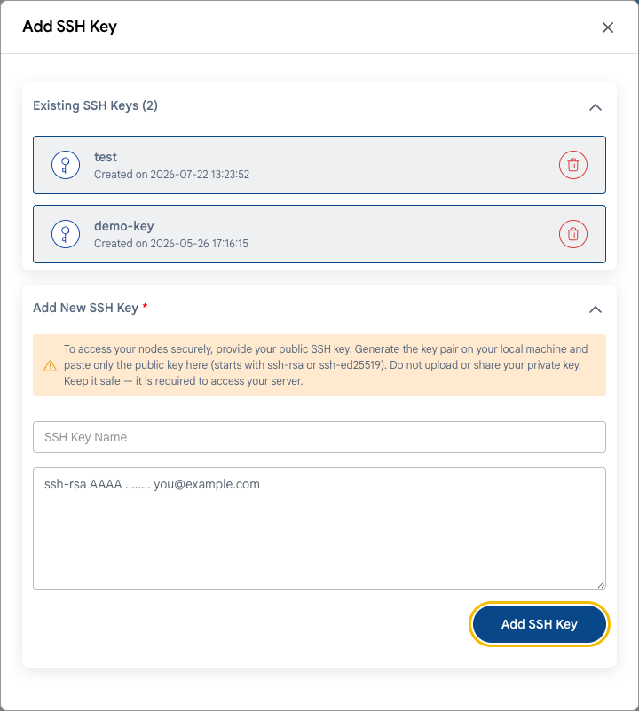

# SSH himoyasi

## Linux VM’larga SSH orqali xavfsiz kirish

SSH orqali parollarni tanlash — ommaviy IP manzilga ega serverlarga qilinadigan eng keng tarqalgan hujum. Botlar internetni skanerlaydi va soatiga minglab parollarni sinab koʻradi. Eng yaxshi himoya — faqat SSH kalitlar orqali kirish.

---

### 1-qadam. SSH kalit qoʻshing

- VM yaratishda **Add SSH Key To Your Instance** blokida ommaviy SSH kalitingizni qoʻshing. **[Virtual mashina](../compute/compute-instance.md)** ga qarang.
- Mavjud VM uchun kalitlarni VM sozlamalarining **SSH Keys** yorligʻida boshqarish mumkin. **[SSH kalitlar](../compute/vm-settings/ssh-keys.md)** ga qarang.



Agar kalitingiz hali boʻlmasa, uni kompyuteringizda yarating:

```bash
ssh-keygen -t ed25519
```

Ommaviy kalit `~/.ssh/id_ed25519.pub` fayliga saqlanadi. Maxfiy kalitni (`.pub` siz `id_ed25519`) hech qachon hech kimga bermang va yuklamang.

### 2-qadam. Parol orqali va root sifatida kirishni oʻchiring

> [!WARNING]
> Avval kalit orqali kira olishingizga ishonch hosil qiling. Joriy SSH seansini yopmang va kirishni ikkinchi terminal oynasida tekshiring. Aks holda serverga kirishni yoʻqotishingiz mumkin. Agar shunday boʻlsa, **[veb-konsoldan](../compute/console-access.md)** foydalaning.

1. Agar root sifatida kirsangiz, sudo huquqiga ega foydalanuvchi yarating:

   ```bash
   adduser admin
   usermod -aG sudo admin    # Ubuntu va Debian
   usermod -aG wheel admin   # Rocky, AlmaLinux, RHEL
   ```

   Kalitingizni ushbu foydalanuvchiga nusxalang (`~/.ssh/authorized_keys`) va u orqali kira olishingizni tekshiring.

2. SSH server konfiguratsiyasini oching:

   ```bash
   sudo nano /etc/ssh/sshd_config
   ```

3. Quyidagi parametrlarni belgilang:

   ```text
   PasswordAuthentication no
   PermitRootLogin no
   ```

   Yangi distributivlarda `/etc/ssh/sshd_config.d/` dagi fayllarni ham tekshiring: ulardagi sozlama asosiy faylni bekor qilishi mumkin.

4. Konfiguratsiyani tekshiring va SSH serverni qayta ishga tushiring:

   ```bash
   sudo sshd -t && sudo systemctl restart ssh    # Ubuntu va Debian
   sudo sshd -t && sudo systemctl restart sshd   # Rocky, AlmaLinux, RHEL
   ```

5. Ikkinchi terminal oynasida kalit orqali kirish hali ham ishlashini tekshiring.

### 3-qadam. Kim ulanishi mumkinligini cheklang

SSH’ga faqat oʻz IP manzillaringizdan yoki VPN orqali ruxsat bering. **[Tarmoqqa kirish](network-access.md)** ga qarang. Portni 22 dan nostandart portga oʻzgartirish jurnallardagi botlar shovqinini kamaytiradi, lekin IP boʻyicha cheklashning oʻrnini bosmaydi.

### 4-qadam. Parollarni tanlashni bloklang

**fail2ban** ni oʻrnating — u koʻp marta muvaffaqiyatsiz kirishga uringan IP manzillarni bloklaydi.

```bash
sudo apt install fail2ban                         # Ubuntu va Debian
sudo dnf install epel-release && sudo dnf install fail2ban   # Rocky, AlmaLinux
sudo systemctl enable --now fail2ban
```

Standart sozlamalar SSH’ni himoya qiladi. Holatni quyidagi buyruq bilan tekshirish mumkin:

```bash
sudo fail2ban-client status sshd
```

---

### Xulosa

IP boʻyicha cheklangan va faqat kalitlar orqali SSH’ga kirish VM’ni eng keng tarqalgan hujumlardan himoya qiladi. Windows VM’lar uchun xuddi shu tamoyillar RDP’ga tegishli — **[Tarmoqqa kirish](network-access.md)** ga qarang.

> [!TIP]
> **Shuningdek qarang:**
>
> - **[Xavfsizlik boʻyicha nazorat roʻyxati](security-checklist.md)**
> - **[SSH orqali ulanish](../compute/connect-with-ssh.md)**
