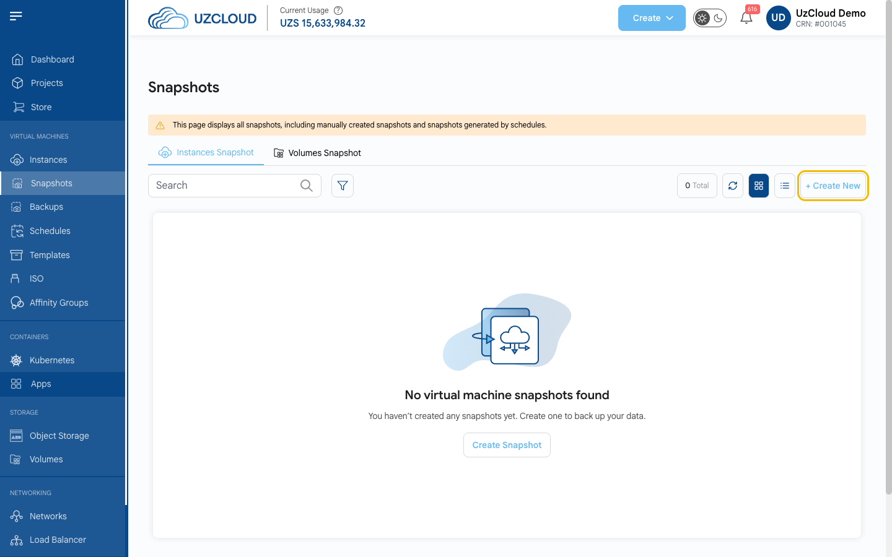

# Operatsion tizimni yangilash

## OT’ni dolzarb holatda saqlang

Muvaffaqiyatli hujumlarning aksariyati tuzatishi allaqachon mavjud boʻlgan zaifliklardan foydalanadi. Yangilanishlarni muntazam oʻrnating va operatsion tizimingiz hali ishlab chiqaruvchidan xavfsizlik tuzatishlarini olishiga ishonch hosil qiling.

---

### 1-qadam. Zaxira nusxa yarating

Har qanday yangilanishdan oldin UzCloud konsolida VM snapshotini oling. **[VM snapshotini yaratish](../vm-snapshots/create-instance-snapshot.md)** ga qarang.



> [!WARNING]
> Ishlayotgan maʼlumotlar bazasining snapshoti har doim ham yaxlit boʻlmaydi. Maʼlumotlar bazalari va muhim konfiguratsiya fayllarini alohida saqlang (masalan, `pg_dump` yoki `mysqldump` yordamida). Zaxira nusxa undan tiklashni sinab koʻrgandan keyingina ishonchli hisoblanadi.

### 2-qadam. Yangilanishlarni oʻrnating

VM’ga SSH orqali ulaning yoki **[veb-konsolni](../compute/console-access.md)** oching va distributivingiz uchun buyruqni bajaring.

**Ubuntu va Debian:**

```bash
sudo apt update && sudo apt upgrade -y
```

**Rocky Linux, AlmaLinux, RHEL, Oracle Linux, CentOS Stream:**

```bash
sudo dnf update -y
```

**SUSE Linux Enterprise / openSUSE:**

```bash
sudo zypper refresh && sudo zypper patch
```

**Windows Server:** **Settings → Windows Update** ni oching va **Check for updates** ni bosing yoki `sconfig` ni ishga tushiring va **Install updates** ni tanlang.

### 3-qadam. Kerak boʻlsa, VM’ni qayta ishga tushiring

Agar yadro yoki tizim kutubxonalari yangilangan boʻlsa, VM’ni qayta ishga tushiring. **Qayta ishga tushirmaguningizcha eski yadro ishlashda davom etadi va zaiflik yopilmaydi.**

Qayta ishga tushirish kerakligini tekshiring:

```bash
# Ubuntu va Debian: qayta ishga tushirish kerak boʻlsa, fayl mavjud boʻladi
ls /var/run/reboot-required

# Rocky Linux, AlmaLinux, RHEL, Oracle Linux
sudo dnf needs-restarting -r

# SUSE
sudo zypper needs-rebooting
```

VM’ni qayta ishga tushiring:

```bash
sudo reboot
```

VM’ni konsoldagi VM sahifasidagi **Reboot** tugmasi bilan ham qayta ishga tushirish mumkin. Qayta ishga tushirilgandan soʻng ishlayotgan yadro versiyasini tekshiring:

```bash
uname -r
```

### 4-qadam. OT’ingiz qoʻllab-quvvatlanishini tekshiring

Distributiv va uning versiyasini aniqlang:

```bash
cat /etc/os-release
```

Qoʻllab-quvvatlash tugash sanasini ishlab chiqaruvchi saytida tekshiring. **Quyidagi versiyalar endi bepul xavfsizlik yangilanishlarini olmaydi:**

- CentOS 7 va CentOS 8 (CentOS Stream 8 ham);
- Ubuntu 20.04 va undan oldingilari;
- Debian 11 va undan oldingilari;
- Windows Server 2012 R2 va undan oldingilari.

Bunday tizimlarda `apt upgrade` yoki `dnf update` yangi zaifliklarni tuzatmaydi. Nima qilish kerak:

1. **Qoʻllab-quvvatlanadigan versiyaga oʻting (tavsiya etiladi).** Dolzarb OT bilan yangi VM yarating (masalan, Ubuntu 24.04 yoki 26.04, Debian 12 yoki 13, Rocky Linux 9 yoki AlmaLinux 9 — ularning barchasi UzCloud’da mavjud), unga ilova, maʼlumotlar va sozlamalarni koʻchiring, eski VM’ni esa orqaga qaytish uchun bir-ikki hafta saqlab qoʻying.
2. **Agar hozircha koʻchirishning iloji boʻlmasa,** ishlab chiqaruvchidan kengaytirilgan qoʻllab-quvvatlashni ulang (masalan, Ubuntu Pro), serverni internetdan yoping va kirishga faqat VPN orqali ruxsat bering — **[Tarmoqqa kirish](network-access.md)** ga qarang.

> [!NOTE]
> Xuddi shu narsa ilovalarga ham tegishli. PHP, Node.js, Python yoki maʼlumotlar bazalarining eski versiyalari (masalan, PHP 7.x yoki PostgreSQL 11 va undan oldingilari) OT qoʻllab-quvvatlansa ham, distributiv repozitoriysidan tuzatishlar olmaydi. Ilovalar versiyalarini ham tekshiring.

### 5-qadam. Avtomatik xavfsizlik yangilanishlarini yoqing

**Ubuntu va Debian:**

```bash
sudo apt install unattended-upgrades
sudo dpkg-reconfigure --priority=low unattended-upgrades
```

**Rocky Linux, AlmaLinux, RHEL, Oracle Linux:**

```bash
sudo dnf install dnf-automatic
sudo systemctl enable --now dnf-automatic-install.timer
```

Avtomatik yangilanishlar tuzatishlarni oʻrnatadi, lekin serverni qayta ishga tushirmaydi. Oyiga bir marta yangilanishlar oʻrnatilganini tekshiring va VM’ni qulay vaqtda qayta ishga tushiring.

---

### Xulosa

Muntazam yangilanishlar va qoʻllab-quvvatlanadigan OT maʼlum zaifliklarning aksariyatini yopadi. Ularni **[SSH himoyasi](ssh-hardening.md)** va **[tarmoqqa kirishni cheklash](network-access.md)** bilan toʻldiring.

> [!TIP]
> **Shuningdek qarang:**
>
> - **[Xavfsizlik boʻyicha nazorat roʻyxati](security-checklist.md)**
> - **[CVE-2026-98432: Linux yadrosidagi TCP zaifligi](bulletins/cve-2026-98432.md)**
