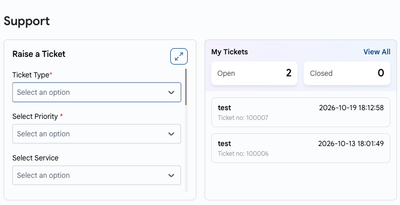

# Qoʻllab-quvvatlash

## Qoʻllab-quvvatlash

UzCloud konsolining **Support** sahifasi murojaatlar yaratish, ularning holatini kuzatish va qoʻllab-quvvatlash xizmati bilan bogʻlanish imkonini beradi.

- Konsol sarlavhasida **Support** sahifasini oching.

### Murojaatlar yaratish va ular bilan ishlash

- **Raise a Ticket** shaklida murojaat turini (**Ticket Type**), ustuvorlikni (**Priority**) va xohishga koʻra savol tegishli boʻlgan xizmatni (**Service**) tanlang.
- Mavzu (**Subject**) va xabarni (**Message**) kiriting. Kerak boʻlsa, fayllarni biriktiring — ularni shaklga torting yoki **Browse files** ni bosing.
- **Submit** tugmasini bosing.
- **My Tickets** boʻlimida ochiq va yopiq murojaatlar soni hamda soʻnggi murojaatlar koʻrsatiladi. Barcha murojaatlar va ularning holatini koʻrish uchun **View All** ni bosing.

### Shoshilinch yordam

- Agar shoshilinch yordam kerak boʻlsa, biz bilan **[info@uzcloud.uz](mailto:info@uzcloud.uz)** elektron pochtasi yoki **[+998 77 718 76 70](tel:+998777187670)** telefon raqami orqali bogʻlaning (har kuni 8:00 dan 21:00 gacha).
- CRN’ingizni (Customer Reference Number) tayyorlab qoʻying — u konsolning yuqori oʻng burchagida ismingiz ostida koʻrsatilgan. Bu yordam koʻrsatishni tezlashtiradi.
