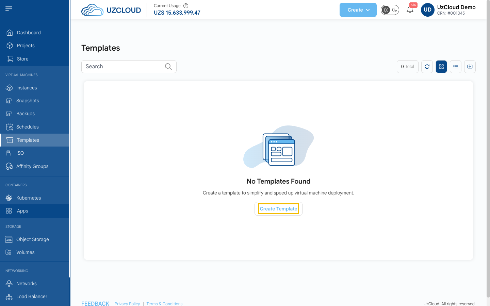
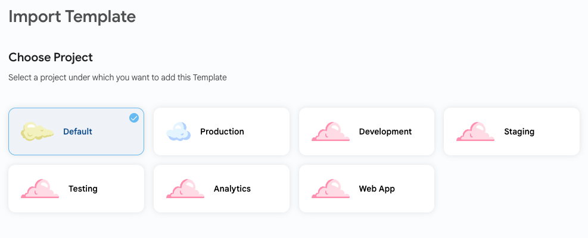
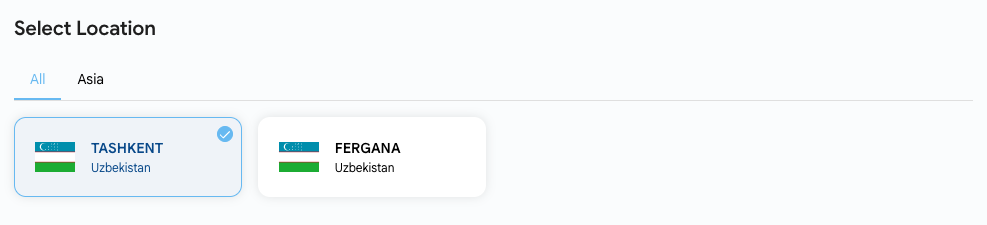
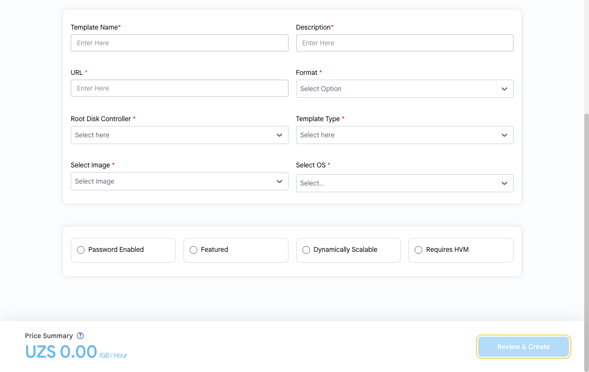

# Shablonlar yaratish

## Virtual mashina shablonlari

**Shablon** — virtual mashinalarni tez joylashtirish uchun oldindan sozlangan disk obrazi. U belgilangan sozlamalar va dasturlarga ega oʻrnatilgan operatsion tizimni oʻz ichiga oladi, shuning uchun har safar OT’ni oʻrnatish va sozlash shart emas.

---

### Shablonni import qilish

- Chap menyuda **Templates** ni bosing. Sahifada shablonlaringiz koʻrsatiladi.
- **Create Template** tugmasini bosing. **Import Template** sahifasi ochiladi.

- Shablon tegishli boʻladigan loyihani tanlang.

- Shablon saqlanadigan joylashuvni tanlang.

### Shablon parametrlari

Majburiy maydonlarni toʻldiring:

- **Template Name** va **Description** — shablon nomi va qisqacha tavsifi.
- **URL** — import qilinadigan obraz fayliga havola.
- **Format** — obraz formati.
- **Root Disk Controller** — asosiy diskdan yuklash uchun kontroller.
- **Template Type** — shablon toifasi.
- **Select Image** va **Select OS** — obraz turi va shablon operatsion tizimi.

Qoʻshimcha parametrlar:

- **Password Enabled** — shablon yangi VM’lar uchun parol oʻrnatishni qoʻllab-quvvatlaydi.
- **Featured** — shablonni tavsiya etilgan deb belgilash.
- **Dynamically Scalable** — shablondan yaratilgan VM’lar resurslarni toʻxtatmasdan oʻzgartirishni qoʻllab-quvvatlaydi.
- **Requires HVM** — shablon apparat virtuallashtirishni (HVM) talab qiladi.

**Price Summary** ni tekshiring (narx har bir GB uchun soatiga hisoblanadi) va **Review & Create** tugmasini bosing.

> [!TIP]
> Shablonni mavjud diskdan ham yaratish mumkin: VM sahifasini oching, **VM Settings** → **Volumes** ga oʻting va disk kartochkasidagi **Create Template** ni bosing.

### Xulosa

Shablonlar bir xil konfiguratsiyaga ega virtual mashinalarni tez va bir xilda joylashtirish imkonini beradi. Yordam kerak boʻlsa, UzCloud hujjatlarini oʻrganing yoki qoʻllab-quvvatlash xizmatiga murojaat qiling.

> [!TIP]
> **Shuningdek qarang:**
>
> - **[Virtual mashina](../compute/compute-instance.md)**
> - **[ISO obrazlar](../isos/import-iso.md)**
