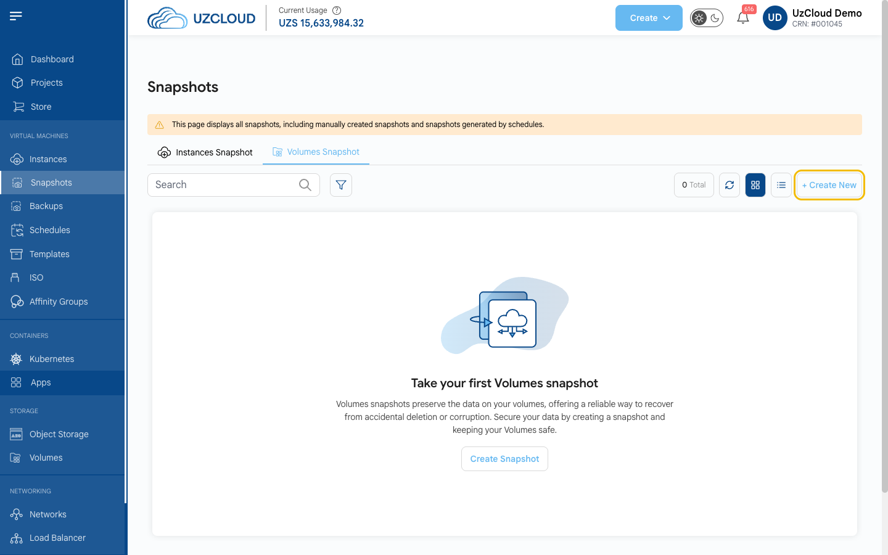
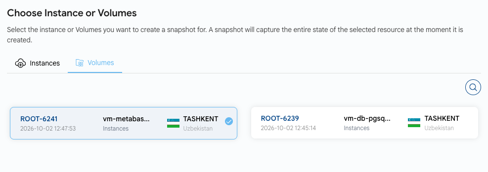

# Disk snapshotini yaratish

## Disk snapshoti

**Disk snapshoti** diskning maʼlum bir vaqtdagi holatini saqlaydi. Undan tasodifiy oʻchirish, maʼlumotlar shikastlanishi yoki muvaffaqiyatsiz yangilanishdan keyin diskni tiklash mumkin.

> [!NOTE]
> Snapshotlar har bir GB uchun soatiga UZS 3,00 dan hisoblanadi. Snapshotni faqat hajmi teng yoki kattaroq diskka tiklash mumkin.

---

### Disk snapshotini yaratish

- Chap menyuda **Snapshots** ni bosing va **Volumes Snapshot** yorligʻini oching. Bu yerda barcha snapshotlar — qoʻlda va jadval boʻyicha yaratilganlari koʻrsatiladi.
- **+ Create New** tugmasini bosing. **Create Snapshot** sahifasi ochiladi.

- Disk joylashgan **loyiha** va **joylashuvni** tanlang.

- **Choose Instance or Volumes** blokida **Volumes** yorligʻini oching va diskni tanlang.

- Noyob **Snapshot Name** ni kiriting.
- **Price Summary** ni tekshiring va **Review And Create Snapshot** tugmasini bosing.

### Xulosa

Disk snapshotlari maʼlumotlarni himoya qilishning oddiy usuli. Snapshotlar avtomatik yaratilishi uchun **Schedules** dan foydalaning. Yordam kerak boʻlsa, UzCloud hujjatlarini oʻrganing yoki qoʻllab-quvvatlash xizmatiga murojaat qiling.

> [!TIP]
> **Shuningdek qarang:**
>
> - **[Disk yaratish](../volumes/create-volume.md)**
> - **[VM snapshoti](../vm-snapshots/create-instance-snapshot.md)**
> - **[Zaxira nusxalar yaratish](../backups/create-backups.md)**
