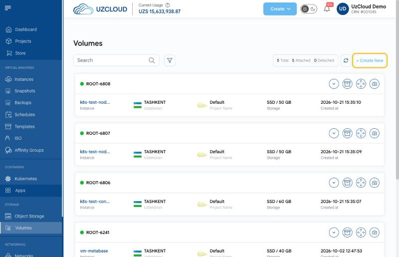
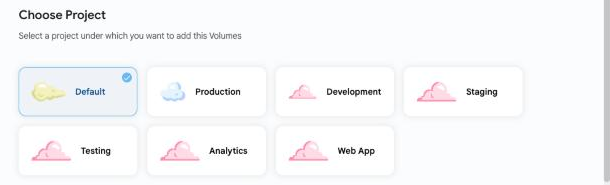
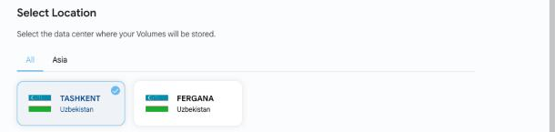
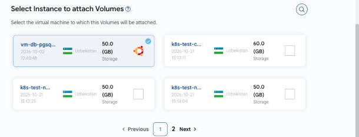
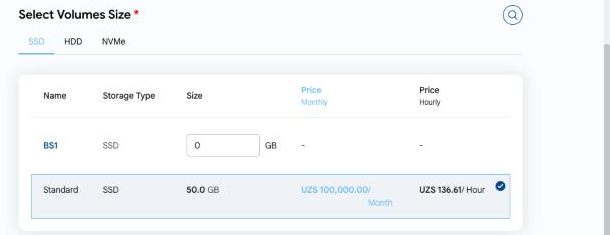
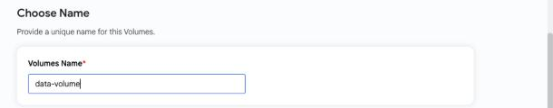

# Disk yaratish

## Blokli xotira disklari

**Blokli xotira disklari** (volume) — virtual mashinalarga ulanadigan va maʼlumotlar uchun koʻproq joy beradigan qoʻshimcha disklar. Ulangandan soʻng diskni VM ichida formatlash va montaj qilish kerak.

---

### Disk yaratish

- Chap menyuda **Volumes** ni bosing. Sahifada barcha disklar koʻrsatiladi: holati (**Attached** — ulangan yoki **Detached** — uzilgan), VM, joylashuv, loyiha, xotira turi va hajmi.
- **+ Create New** tugmasini bosing. **Create Volumes** sahifasi ochiladi.

### Loyihani tanlash

- Disk tegishli boʻladigan loyihani tanlang.

### Joylashuvni tanlash

- Disk saqlanadigan maʼlumotlar markazini tanlang: **TASHKENT** yoki **FERGANA**.

### Virtual mashinani tanlash

- Disk ulanadigan virtual mashinani tanlang. Diskni faqat mavjud VM uchun yaratish mumkin; agar VM boʻlmasa, **Create Instances** ni bosing.

### Disk hajmini tanlash

- **Select Volumes Size** blokida disk turini (**SSD**, **HDD** yoki **NVMe**) va variantni tanlang. Tayyor hajmni tanlash yoki oʻz hajmingizni GB’da kiritish mumkin.

### Disk nomi

- **Volumes Name** maydoniga noyob nom kiriting.

### Diskni yaratish

- Sahifaning pastki qismida **Billing Cycle** (**Monthly** yoki **Yearly**) ni tanlang va **Price Summary** ni tekshiring.
- Diskni yaratish uchun **Review & Deploy** tugmasini bosing.

### Xulosa

Ushbu qoʻllanmaga amal qilib, siz UzCloud’da disklarni yaratishingiz va ularni virtual mashinalarga ulashingiz mumkin. Muayyan VM disklarini uning **VM Settings** yorligʻida ham boshqarish mumkin. Yordam kerak boʻlsa, UzCloud hujjatlarini oʻrganing yoki qoʻllab-quvvatlash xizmatiga murojaat qiling.

> [!TIP]
> **Shuningdek qarang:**
>
> - **[Blokli xotira](../compute/vm-settings/block-storage.md)**
> - **[Disk snapshoti](../volume-snapshots/create-volume-snapshot.md)**
> - **[VM snapshoti](../vm-snapshots/create-instance-snapshot.md)**
